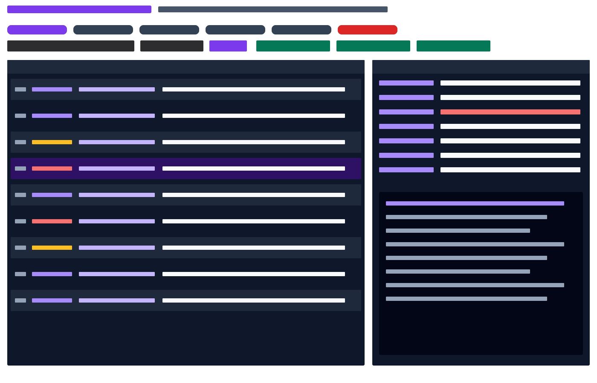

# Makefile & Justfile Graph View for VS Code

Inspect `Makefile`, `GNUmakefile`, `*.mk`, `justfile`, `Justfile` and `*.just` files in VS Code without running `make`, executing `just`, or calling any cloud service. Large task runners often hide missing `.PHONY` declarations on `build`, `test` or `clean` targets, recursive `=` assignments around `$(shell ...)` that re-run on every use, `curl | sh` or unquoted `rm -rf` recipe lines, duplicate targets, or undefined variable references. This extension parses Makefiles and Justfiles locally in plain JavaScript with zero shell execution and zero network calls.

## What it opens

- `Makefile`, `GNUmakefile` and `*.mk` GNU Make files (targets, prerequisites, `.PHONY`, variables, includes and recipes).
- `justfile`, `Justfile` and `*.just` Just command runner files (recipes, parameters, dependencies, attributes, variables and imports).
- Any matching file via the Command Palette or Explorer context menu (Open in Makefile & Justfile Graph View).
- Nothing to install, no `make` or `just` process started, no cloud or network calls.

## The free part

- Build header summary: shows file kind (`Makefile` or `Justfile`), default target, line count, and counts for targets/recipes, dependency edges, `.PHONY` declarations, variables and includes.
- Target & recipe dependency DAG: lists every target with its prerequisites, `.PHONY` status, parameters and recipe command summary.
- Variables & `.PHONY` table: shows variable names, assignment operators (`=`, `:=`, `?=`, `+=`), values and line numbers.
- Static findings: flags missing `.PHONY` on build/test/clean targets, recursive `=` vs `:=` shell hazards, `curl | sh` pipes, unquoted `rm -rf` variable expansions, duplicate targets, and undefined variable references.

## The Pro tools, with 1 free try

Pro adds the audit, diff and export steps: generate a Markdown Makefile/Justfile safety and `.PHONY` audit for one file or a folder, compare two Makefiles or Justfiles in Markdown, or export a Mermaid target DAG plus Markdown and CSV target and variable catalogs locally. Your first try of each Pro tool is free. Zovo Pro is USD 19 once, and the team licence is USD 59.

## Why not plain text

Reading a 400-line `Makefile` or `justfile` in plain text makes it easy to miss which targets chain together, which phony target is missing from `.PHONY`, where `=` re-executes `$(shell ...)` repeatedly, or where an unquoted `rm -rf $(DIR)` can wipe the wrong path. A local graph viewer puts the target DAG, variables, recipes and static findings on one screen.

## More tools by Zovo

See full docs and install options at [vscode.zovo.one/extensions/zovo-makefile-justfile-viewer/](https://vscode.zovo.one/extensions/zovo-makefile-justfile-viewer/), browse all Zovo VS Code extensions at [vscode.zovo.one](https://vscode.zovo.one/), or explore [Zovo Pro](https://vscode.zovo.one/pro/).
